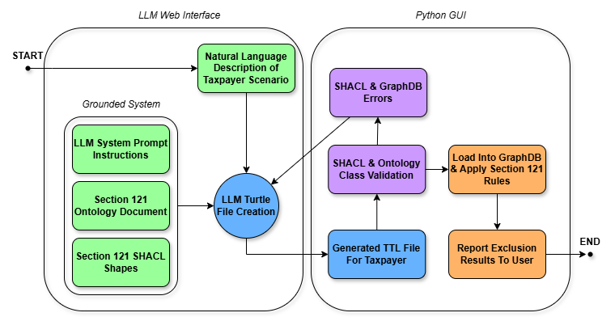

# §121 Exclusion Calculation System — Version 1.0

A proof of concept knowledge graph–driven application for evaluating **IRC §121 home sale exclusion** scenarios. The system converts plain-English taxpayer descriptions into RDF/Turtle (`.ttl`) facts according to a predefined ontology via a large language model, validates and stores the information in a GraphDB knowledge graph, runs a chain of SPARQL queries to calculate results, and finally produces a readable determination of the taxpayer's exclusion.

> **Note:** Version 1.0 implements only the following provisions of IRC §121: `121(a)`, `121(b)(1)`, `121(b)(2)(A)`, `121(b)(2)(B)`, `121(b)(3)`, `121(c)`, `121(d)(1)`. See [Known Limitations](#16-known-limitations).

---

## Table of Contents

1. [Project Overview](#1-project-overview)
2. [Architecture &amp; Pipeline](#2-architecture--pipeline)
3. [Repository Structure](#3-repository-structure)
4. [Prerequisites](#4-prerequisites)
5. [Installation &amp; Setup](#5-installation--setup)
6. [Configuration](#6-configuration)
7. [Running the Application](#7-running-the-application)
8. [Using the Application](#8-using-the-application)
   - [Tab 1 — TTL Editor](#tab-1--ttl-editor)
   - [Tab 2 — Prompt Builder](#tab-2--prompt-builder)
   - [Tab 3 — How to Use](#tab-3--how-to-use)
9. [Knowledge Graph Components](#9-knowledge-graph-components)
   - [Ontology](#ontology)
   - [SHACL Shapes](#shacl-shapes)
   - [SPARQL Queries](#sparql-queries)
10. [LLM Prompting System](#10-llm-prompting-system)
11. [Output Format &amp; Interpretation](#11-output-format--interpretation)
12. [Evaluation &amp; Testing](#12-evaluation--testing)
13. [Module Reference](#13-module-reference)
14. [Keyboard Shortcuts](#14-keyboard-shortcuts)
15. [Troubleshooting](#15-troubleshooting)
16. [Known Limitations](#16-known-limitations)
17. [License &amp; Citation](#17-license--citation)

---

## 1. Project Overview

IRC §121 permits taxpayers to exclude up to $250,000 (single) or $500,000 (joint) of gain realized on the sale of a principal residence, contingent on satisfaction of ownership and use tests, frequency limitations, and partial-exclusion provisions. Consistent application of these rules across complex fact patterns such as co-ownership arrangements, multiple dispositions, partial exclusions, and same-day loss offsets is often difficult to achieve manually due to the density and interdependence of the statutory language.

This project encodes §121 as a **formal knowledge graph** and automates the evaluation and calculation of property sale exclusions using the following:

- A **custom OWL ontology** represents taxpayer facts (ownership intervals, residence intervals, dispositions, returns, etc.).
- **SHACL shapes** enforce the structural validity of the formatted data before any query-based reasoning is applied.
- **SPARQL UPDATE** queries encode the §121 rule application (of the implemented subset), using named subgraphs to keep each reasoning step isolated and independently verifiable.
- A **Python/tkinter desktop GUI** orchestrates the entire pipeline and displays results back to the user.
- A **structured prompting system** guides an LLM (ChatGPT / Claude / Gemini) to convert natural-language scenarios into syntactically correct Turtle files through constrained generation, role assignment, and iterative error correction.

---

## 2. Architecture & Pipeline



*Left — the grounded LLM interface: the system prompt, the §121 ontology and the SHACL shapes are supplied alongside the natural-language scenario, and the LLM returns a Turtle file. Right — the Python GUI: SHACL and ontology-class validation, GraphDB load, rule application and reporting, with any validation errors routed back to the LLM for repair.*

**Detailed step sequence (`controller.py`):**

```
Plain-English Scenario
        │
        ▼
┌───────────────────┐
│  Prompt Builder   │  Assembles pre-prompt + ontology + SHACL + user scenario
│  (Tab 2 in GUI)   │
└────────┬──────────┘
         │  Full prompt copied to clipboard
         ▼
┌───────────────────┐
│   LLM of Choice   │  ChatGPT / Claude / Gemini
│  (external)       │  Returns RDF/Turtle inside a code block
└────────┬──────────┘
         │  TTL pasted / loaded into editor
         ▼
┌───────────────────────────────────────────────────────┐
│                  §121 Pipeline  (controller.py)       │
│                                                       │
│  Step 1  Upload TTL ──► GraphDB; SHACL gate on commit │
│                                                       │
│  Step 2  Violations? ──► rejected, reported as Error  │
│                                                       │
│  Step 3  NYI Check (NYICheck.sparql) ─── warnings?    │
│                                                       │
│  Step 4  DerivedInfoQuery.sparql  (SPARQL UPDATE)     │
│          InterpretationQuery.sparql (SPARQL UPDATE)   │
│                                                       │
│  Step 5  ResultsQuery.sparql (SPARQL SELECT)          │
│          │                                            │
│          ▼                                            │
│      formatter.py ──► Human-readable exclusion output │
└───────────────────────────────────────────────────────┘
```

**Key design decisions:**

- All legal reasoning lives in SPARQL — the LLM only converts facts into Turtle; it never applies tax law.
- SHACL validation acts as a hard gate; a violation prevents any reasoning from running.
- The NYI (Not-Yet-Implemented) check flags entities that are not defined in the ontology, producing warnings without hard-stopping the pipeline. These warnings are meant to act as caution signs for the user when viewing the proposed results.
- The dollar limitations are applied in SPARQL, one per (taxpayer, disposition) row: the §121(b)(1) $250,000 single-return limitation, the §121(b)(2)(A) $500,000 joint limitation, and the §121(b)(2)(B) half-share of the joint limitation. A same-day loss is then netted against the gain it accompanies at the return level — Reg. §1.121-1(b)(3) treats a dwelling and its adjacent vacant land as one sale. The formatter performs no arithmetic of its own; every figure it prints is a value the query returned.

---

## 3. Repository Structure

```
Section121TaxLaw/
│
├── App/                                 # Python application package
│   ├── __init__.py
│   ├── main.py                          # Entry point; GUI assembly (tkinter)
│   ├── controller.py                    # Backend logic; pipeline orchestration
│   ├── formatter.py                     # Result formatting; cap & offset logic
│   ├── graphdb_client.py                # HTTP calls to GraphDB REST API
│   ├── config.py                        # GraphDB URL & named-graph constants
│   ├── theme.py                         # UI color & font constants
│   └── widgets.py                       # Reusable styled tkinter widget factories
│
├── Prompting_Files/
│   ├── Combined_Prompting_File          # Full LLM system prompt (instructions + ontology + SHACL)
│   ├── Taxpayer_TTL_LLM_Instructions    # Standalone LLM instructions (subset of Combined)
│   ├── Section_121_Taxpayer_Ontology.ttl
│   └── Section_121_SHACL_Shapes.ttl
│
├── SPARQL_Queries/
│   ├── DerivedInfoQuery.sparql      # SPARQL UPDATE — computes derived ownership/use facts
│   ├── InterpretationQuery.sparql   # SPARQL UPDATE — applies §121 rule logic
│   ├── NYICheck.sparql              # SPARQL SELECT — checks for undefined entities
│   └── ResultsQuery.sparql          # SPARQL SELECT — retrieves final exclusion results
│
├── Taxpayer_Scenarios/
│   ├── Accuracy_Validation_Cases/       # 77 hand-verified test cases (SPARQL pipeline accuracy)
│   ├── Evaluation_Cases/                # 231 cases (77 × 3 runs) for full NL→Output evaluation
│   ├── Test_Cases/                      # 30 Federal Regulations Test Cases (original prototype set)
│   └── Incorrect_Example_Cases/         # 10 annotated examples of typical LLM/pipeline errors
│
├── Results/
│   ├── Section_121_IRC_Original_Test_Cases.xlsx      # Results for the 30 Federal Regulations Test Cases
│   ├── Section_121_Accuracy_Validation_Cases.xlsx    # Results for the 77 Accuracy Validation Cases
│   └── Section_121_Final_Evaluation_Cases.xlsx       # Results for the 231 Evaluation Cases (primary benchmark)
│
├── Docs/
│   └── pipeline_overview.png            # Architecture diagram used in §2
│
├── debug_results.py                     # CLI diagnostic; batch-runs scenario files
│                                        # and prints raw ResultsQuery bindings,
│                                        # bypassing formatter.py. Not used by the GUI.
│
├── reproduce_results.py                 # Recomputes the paper's reported statistics
│                                        # from the workbooks in Results/. Does not run
│                                        # the pipeline; needs neither GraphDB nor the app.
│
└── requirements.txt                     # Python dependencies: requests, openpyxl
```

**`debug_results.py`** runs the same pipeline as the GUI but stops one step short of
`formatter.py`, printing the bindings exactly as GraphDB returned them. It is the tool
to reach for when the question is what the SPARQL layer produced rather than how the
result reads:

```bash
.venv\Scripts\python debug_results.py T046            # one case
.venv\Scripts\python debug_results.py T001-T077       # a range
.venv\Scripts\python debug_results.py T046 --all      # every variable, not just gains
.venv\Scripts\python debug_results.py T046 --json
```

**`reproduce_results.py`** recomputes the statistics reported in the paper directly from
the workbooks in `Results/`, and prints each figure beside the one the paper gives. It
does not run the pipeline, so it needs neither GraphDB nor the app, only `openpyxl`:

```bash
.venv\Scripts\python reproduce_results.py               # both workbooks
.venv\Scripts\python reproduce_results.py validation    # 77 Accuracy Validation Cases
.venv\Scripts\python reproduce_results.py evaluation    # 231 Evaluation Cases (Tables 2 and 3)
```

It exits 1 if a figure is not reproduced, so it can be used as a check.

> **Note:** `Combined_Prompting_File` is automatically read by `main.py` at startup and pre-loaded into the Prompt Builder. Do not move or rename it without updating the path in `main.py`.

---

## 4. Prerequisites

| Requirement  | Version             | Notes                                                          |
| ------------ | ------------------- | -------------------------------------------------------------- |
| Python       | 3.9 +               | 3.11+ recommended [Download](https://www.python.org/downloads/) |
| tkinter      | bundled with Python | Confirm with `python -m tkinter`                             |
| GraphDB Free | 10.8 +              | [Download](https://graphdb.ontotext.com/)                       |
| requests     | ≥ 2.28             | `pip install requests`                                       |
| openpyxl     | ≥ 3.1              | `pip install openpyxl` — only for `reproduce_results.py`  |

`requests` is needed by the app and `debug_results.py`; `openpyxl` only by
`reproduce_results.py`. Both are listed in `requirements.txt`. No other third-party
Python libraries are required.

You will also need access to at least one LLM (ChatGPT, Claude, or Gemini) through your browser — direct links are provided inside the application.

> **Platform:** Version 1.0 is developed and tested on Windows. The UI layer contains macOS
> handling (`App/theme.py`, `App/widgets.py`), but the application has not been run on macOS
> or Linux and portability to those platforms is untested. See
> [Known Limitations](#16-known-limitations).

---

## 5. Installation & Setup

### 5.1 Clone the Repository

```bash
git clone https://github.com/AndrewCSAllison/Section121TaxLaw.git
cd Section121TaxLaw
```

### 5.2 Create and Activate a Virtual Environment

```bash
python -m venv .venv
```

Activate it before installing anything, so the dependencies land in the environment
rather than in your system Python:

```powershell
# Windows (PowerShell / cmd)
.venv\Scripts\activate
```

```bash
# macOS / Linux (bash / zsh)
source .venv/bin/activate
```

### 5.3 Install Python Dependencies

```bash
pip install -r requirements.txt
```

### 5.4 Install & Configure GraphDB

1. Download and install **GraphDB Free** from [https://graphdb.ontotext.com/](https://graphdb.ontotext.com/).
2. Start the GraphDB server (default port: `7200`).
3. Open the GraphDB Workbench at `http://localhost:7200`.
4. Create a new repository:
   - Navigate to **Setup → Repositories → Create new repository**.
   - Repository type: **GraphDB Repository**.
   - Repository ID: `Section121TaxLaw` *(name must match `config.py`)*.
   - Enable the **SHACL** plugin: under the "Validation" section, set **SHACL validation** to **enabled**.
   - Leave all other settings at their defaults and click **Create**.

### 5.5 Load Base Ontology & SHACL Shapes

The application can reload these automatically via the **⟳ Reset Repository** button, but you can also load them manually through the GraphDB Workbench:

1. Import `Prompting_Files/Section_121_Taxpayer_Ontology.ttl` into the named graph:
   `http://example.org/section121/Ontology`
2. Import `Prompting_Files/Section_121_SHACL_Shapes.ttl` into the named graph:
   `http://rdf4j.org/schema/rdf4j#SHACLShapeGraph`

Once loaded, the repository is ready for use.

> **How resets treat these graphs:** **⟳ Reset Repository** issues a `CLEAR ALL`, which
> drops the ontology and SHACL graphs along with everything else, and then re-uploads
> both files from disk. They are *restored* after each reset, not preserved — so any
> edit you make to these graphs inside the GraphDB Workbench is lost on the next reset,
> while any edit you make to the two `.ttl` files on disk is picked up.

---

## 6. Configuration

All connection settings are in `App/config.py`:

```python
GRAPHDB_REPO  = "http://localhost:7200/repositories/Section121TaxLaw"
SHACL_GRAPH   = "http://rdf4j.org/schema/rdf4j#SHACLShapeGraph"
ONTOLOGY_GRAPH = "http://example.org/section121/Ontology"
```

| Variable           | Purpose                                      |
| ------------------ | -------------------------------------------- |
| `GRAPHDB_REPO`   | Full URL of the GraphDB repository endpoint  |
| `SHACL_GRAPH`    | Named graph where SHACL shapes are stored    |
| `ONTOLOGY_GRAPH` | Named graph where the OWL ontology is stored |

If you use a different port, host, or repository name, update `GRAPHDB_REPO` accordingly. Leave `SHACL_GRAPH` and `ONTOLOGY_GRAPH` alone unless you named those graphs differently when importing them in the GraphDB Workbench — `SHACL_GRAPH` in particular is the fixed URI RDF4J reserves for shape storage.

---

## 7. Running the Application

```bash
# From the repository root
python -m App.main
```

The application window opens at 1100 × 700 px (minimum 900 × 600). It consists of three tabs: **TTL Editor**, **Prompt Builder**, and **How to Use**.

*Note - GraphDB must be configured & running in the background PRIOR to running the application.*

---

## 8. Using the Application

### Recommended Workflow

```
Prompt Builder tab  →  External LLM  →  TTL Editor tab  →  View Results
```

---

### Tab 1 — TTL Editor

The primary working tab. Split into two panels:

**Left panel — Turtle Input**

| Control               | Action                                                                       |
| --------------------- | ---------------------------------------------------------------------------- |
| Text area             | Paste or type the TTL content generated by the LLM                           |
| 📂 Load File          | Opens a file picker to load a `.ttl` file from disk                        |
| ✕ Clear              | Clears the editor                                                            |
| ▶ Submit & Run Rules | Uploads the TTL and runs the full §121 pipeline                             |
| ⟳ Reset Repository   | Clears all triples from GraphDB and reloads the base ontology + SHACL shapes |
| Char counter          | Live character count shown below the editor                                  |

**Right panel — Pipeline Output**

Displays timestamped, color-coded pipeline progress:

| Color       | Symbol | Meaning                                                               |
| ----------- | ------ | --------------------------------------------------------------------- |
| Grey        | —     | Neutral status line ("Uploading TTL…", "Running SHACL validation…") |
| Green       | ✔     | Step completed successfully                                           |
| Red         | ✘     | Error — pipeline halted; review message and fix TTL                  |
| Yellow      | ⚠     | Warning — undefined entities detected; pipeline continues            |
| Blue (bold) | —     | Section heading / submission timestamp                                |
| White       | —     | Final exclusion results                                               |

The **Copy** button copies all output text to the clipboard. The **Clear** button resets the output panel.

**Important:** Before submitting a *new* scenario, always click **⟳ Reset Repository** to prevent data from a previous scenario from interfering with the current one. If unexpected errors occur, clicking **⟳ Reset Repository** usually resolves them by restoring the GraphDB setup to its original state with no uploaded TTL files.

---

### Tab 2 — Prompt Builder

Assembles the complete LLM prompt from your scenario description.

**Left panel — Your Scenario**

1. Click **▶ What to include in your scenario** to expand the checklist of required facts.
2. Write a plain-English description of the taxpayer scenario in the text box. Include:

   - Taxpayer name(s) and marital/filing status
   - Property name(s)
   - Ownership start/end date per taxpayer per property, and percentage owned if split
   - Residence start/end date per taxpayer per property
   - Sale date and realized gain (positive) or loss (negative) per property
   - Return type (Single or Joint) and which taxpayers / dispositions belong to it
   - Partial exclusion reason, if applicable: Employment-related, Health-related, Unforeseen circumstance, or Non-qualifying

   > **Tip:** Dates and amounts can be written naturally — `"January 15, 1999"`, `"early 2003"`, `"$300k"`, `"three hundred thousand dollars"` — the LLM will convert them to the correct XSD datatypes.
   >
   > **Do not** compute or include exclusion amounts; those are calculated automatically by the SPARQL pipeline.
   >
3. Click **⚙ Build Prompt** to assemble the full prompt in the right panel.

**Right panel — Assembled Prompt**

The pre-loaded system instructions (from `Combined_Prompting_File`) are shown first, followed by your scenario text after clicking Build Prompt.

| Control             | Action                                                    |
| ------------------- | --------------------------------------------------------- |
| ⚙ Build Prompt     | Concatenates pre-prompt + scenario; populates right panel |
| 📋 Copy Full Prompt | Copies the assembled prompt to clipboard                  |
| ↗ ChatGPT          | Opens `https://chat.openai.com/` in your browser        |
| ↗ Claude           | Opens `https://claude.ai/new` in your browser           |
| ↗ Gemini           | Opens `https://gemini.google.com/app` in your browser   |

After copying the prompt, paste it into the LLM of your choice. The LLM will either return a Turtle file inside a Markdown code block or ask you to clarify missing facts. Answer its questions until it produces the file, then copy the full TTL output (including all `@prefix` lines) and paste it into the TTL Editor.

---

### Tab 3 — How to Use

A scrollable, step-by-step in-app guide that mirrors the workflow above. Useful as a quick reference while working.

---

## 9. Knowledge Graph Components

### Ontology

**File:** `Prompting_Files/Section_121_Taxpayer_Ontology.ttl`
**Named graph:** `http://example.org/section121/Ontology`
**Namespace prefix:** `:` → `http://example.org/section121#`

The ontology declares the following classes — these are the complete set available to the LLM:

| Class                     | Description                                                                               |
| ------------------------- | ----------------------------------------------------------------------------------------- |
| `:Taxpayer`             | An individual taxpayer                                                                    |
| `:Property`             | A real property asset                                                                     |
| `:OwnershipUseInterval` | A contiguous period during which a taxpayer owned a property                              |
| `:ResidenceUseInterval` | A contiguous period during which a taxpayer used a property as a principal residence      |
| `:Disposition`          | A sale or other disposition of a property                                                 |
| `:Return`               | A tax return (superclass)                                                                 |
| `:SingleReturn`         | A single-filer return (exclusion cap: $250,000); declared via `rdfs:subClassOf :Return` |
| `:JointReturn`          | A joint-filer return (exclusion cap: $500,000); declared via `rdfs:subClassOf :Return`  |
| `:ReasonType`           | A §121(c) partial exclusion reason type                                                  |

> **`:DerivedInfo` and `:Interpretation` are named graphs.**
> The two UPDATE queries write into `GRAPH :DerivedInfo` and `GRAPH :Interpretation`,
> and additionally type each node they create with the matching bare IRI. Neither name is
> declared in the ontology file — which is also why `NYICheck.sparql` scopes itself to the
> default graph and never reports them as undefined. A generated TTL file should never
> assert triples in either namespace.

Key individuals of `:ReasonType`:

| Individual                        | Meaning                                           |
| --------------------------------- | ------------------------------------------------- |
| `:EmploymentRelatedReason`      | Job change, reassignment, job loss                |
| `:HealthRelatedReason`          | Illness, injury, or care for a family member      |
| `:UnforeseenCircumstanceReason` | Divorce, death, financial hardship, etc.          |
| `:NonQualifyingReason`          | Explicitly does not qualify for partial exclusion |

Key datatype properties. The ontology declares domain and range only; the **Required**
column reflects the `sh:minCount` constraints in the SHACL shapes, which are what actually
reject a file:

| Property             | Domain                    | Range           | Required (SHACL) | Constraint        |
| -------------------- | ------------------------- | --------------- | ---------------- | ----------------- |
| `:ownershipStart`  | `:OwnershipUseInterval` | `xsd:date`    | Yes (exactly 1)  | —                |
| `:ownershipEnd`    | `:OwnershipUseInterval` | `xsd:date`    | Yes (exactly 1)  | —                |
| `:percentageOwned` | `:OwnershipUseInterval` | `xsd:decimal` | No (0 or 1)      | in [0, 1]         |
| `:residenceStart`  | `:ResidenceUseInterval` | `xsd:date`    | Yes (exactly 1)  | —                |
| `:residenceEnd`    | `:ResidenceUseInterval` | `xsd:date`    | Yes (exactly 1)  | —                |
| `:sellDate`        | `:Disposition`          | `xsd:date`    | Yes (exactly 1)  | —                |
| `:potentialGain`   | `:Disposition`          | `xsd:integer` | Yes (exactly 1)  | negative = loss   |
| `:exclusionCap`    | `:Return`               | `xsd:integer` | Yes (exactly 1)  | 250,000 / 500,000 |

Key object properties:

| Property                    | Domain                    | Range                     |
| --------------------------- | ------------------------- | ------------------------- |
| `:owns`                   | `:Taxpayer`             | `:OwnershipUseInterval` |
| `:uses`                   | `:Taxpayer`             | `:ResidenceUseInterval` |
| `:disposesOf`             | `:Taxpayer`             | `:Disposition`          |
| `:hasOwnershipOf`         | `:OwnershipUseInterval` | `:Property`             |
| `:hasResidenceOf`         | `:ResidenceUseInterval` | `:Property`             |
| `:involves`               | `:Disposition`          | `:Property`             |
| `:associates`             | `:Return`               | `:Taxpayer`             |
| `:linkedTo`               | `:Return`               | `:Disposition`          |
| `:partialExclusionReason` | `:Disposition`          | `:ReasonType`           |

---

### SHACL Shapes

**File:** `Prompting_Files/Section_121_SHACL_Shapes.ttl`
**Named graph:** `http://rdf4j.org/schema/rdf4j#SHACLShapeGraph`

SHACL validation is run before any SPARQL reasoning. Violations halt the pipeline. The shapes enforce:

| Shape                          | Key constraints                                                                                                                                                       |
| ------------------------------ | --------------------------------------------------------------------------------------------------------------------------------------------------------------------- |
| `:TaxpayerShape`             | Ensures `:owns`, `:uses`, `:disposesOf` point to correct classes                                                                                                |
| `:OwnershipUseIntervalShape` | Exactly one `:hasOwnershipOf` (Property); exactly one `:ownershipStart` and `:ownershipEnd`; optional `:percentageOwned` in [0, 1]                            |
| `:ResidenceUseIntervalShape` | Exactly one `:hasResidenceOf`; exactly one `:residenceStart` and `:residenceEnd`                                                                                |
| `:DispositionShape`          | Exactly one `:involves` (Property); exactly one `:sellDate`; exactly one `:potentialGain`; optional `:partialExclusionReason` from the four valid individuals |
| `:ReturnShape`               | At least one `:associates` (Taxpayer); at least one `:linkedTo` (Disposition)                                                                                     |
| `:SingleReturnShape`         | `:exclusionCap` must be exactly 250,000                                                                                                                             |
| `:JointReturnShape`          | `:exclusionCap` must be exactly 500,000                                                                                                                             |

---

### SPARQL Queries

All SPARQL files live in `SPARQL_Queries/`.

#### `NYICheck.sparql` — Undefined Entity Check (SELECT)

Scans the base data graph for any classes or properties not declared in the ontology named graph. Returns a table of `(?s, ?undefined, ?type)` bindings. Results are shown as warnings (yellow) and do not halt the pipeline.

#### `DerivedInfoQuery.sparql` — Derived Facts (UPDATE)

Computes intermediate facts and writes them into the `:DerivedInfo` named graph, one node per (taxpayer, disposition). Each node carries ownership and residence day counts inside the five-year window, the same counts for a spouse, the lookback to the taxpayer's most recent prior sale, the ownership percentage, and the **gain attribution** — which spouse on a joint return carries the sale's gain (`:gainShare`, `:coFilerOnDisposition`, `:coFilerRanksFirst`).

#### `InterpretationQuery.sparql` — Rule Application (UPDATE)

Applies the §121 rule logic and writes conclusions into the `:Interpretation` named graph, again one node per (taxpayer, disposition). It re-derives the gain attribution on the post-§121(b)(3) outcome rather than reusing the derived share, because §121(b)(3) can disqualify a spouse after the day tests pass, and that changes who carries the gain. Covers:

- **§121(a)** — principal residence ownership and use tests (2-of-5 year rules)
- **§121(b)(1)** — single-return exclusion cap ($250,000)
- **§121(b)(2)(A)** — joint-return exclusion, both spouses qualify
- **§121(b)(2)(B)** — joint-return exclusion, one spouse qualifies
- **§121(b)(3)** — frequency limitation (not more than once every 2 years)
- **§121(c)** — reduced maximum exclusion (partial exclusion) for employment, health, or unforeseen circumstance
- **§121(d)(1)** — joint return rule (either spouse may satisfy ownership and use requirements)

> **§121(c)(1) and §121(c)(2) are implemented as one combined rule.** Both are distinct
> provisions of the statute, and both are implemented. §121(c)(2) sets the eligibility
> condition: the sale must be by reason of a change in place of employment, health, or
> unforeseen circumstances (§121(c)(2)(B)), and the taxpayer must have failed the §121(a) tests
> or been barred by §121(b)(3) (§121(c)(2)(A)). §121(c)(1) then supplies the ratio that reduces
> the limitation. The knowledge graph represents the two with a single `:Rule121cExcluded`
> binding rather than one apiece, because they interlock: the binding's condition is
> §121(c)(2) and its value is §121(c)(1)'s `numeratorDays / 730 × $250,000`, and neither can be
> evaluated independently of the other. The `!?Rule121aFinal` term covers both prongs of
> §121(c)(2)(A), since `Rule121aFinal` is already forced false wherever §121(b)(3) applies.
> Results therefore report a single `§121(c)` rule; a claim refused for a reason outside the
> three §121(c)(2)(B) circumstances is reported separately as `:Rule121cReasonNonQualifying`.

#### `ResultsQuery.sparql` — Final Results (SELECT)

Reads the `:Interpretation` graph and joins it against `:DerivedInfo` and the base data for taxpayer, property, sale date, realized gain, and excluded gain values. It also computes the totals the formatter prints: per-sale figures (`?saleRealizedGain` / `?saleExcludedGain` / `?saleTaxableGain`), and the same-day netting required by Reg. §1.121-1(b)(3), grouped on (return, sell date) — the return so both spouses of a joint filing land in one group, the sell date so a residence sold in another year never nets into this one. A loss absorbs taxable gain first, and only what is left of it reduces the exclusion.

---

## 10. LLM Prompting System

The **Combined Prompting File** (`Prompting_Files/Combined_Prompting_File`) is the single document sent to the LLM. It contains, in order:

1. **Role and scope instructions** — The LLM's sole task is Turtle generation and repair. It must not interpret tax law, apply legal reasoning, compute exclusions, or infer missing facts.
2. **Allowed tasks** — Convert NL to Turtle; repair Turtle given SHACL/NYI error messages; preserve correct triples; ask clarifying questions for missing facts.
3. **Output requirements** — Valid Turtle syntax only, inside a Markdown code block, no prose outside the code block.
4. **Ontology compliance rules** — Use only declared classes, properties, and individuals; no invented predicates; no `:DerivedInfo` or `:Interpretation` triples.
5. **Datatypes** — The XSD datatype required for each kind of literal, and a standing instruction never to omit one.
6. **Specific §121 modeling rules** — Complete `@prefix` block, property linking requirement, instantiation requirement, sign convention for gains and losses, exclusion caps, co-owned-sale modeling (one `:Disposition`, shares via `:percentageOwned`), non-continuous interval modeling.
7. **Missing or ambiguous information** — Do not guess values or infer dates; ask instead.
8. **Error handling instructions** — How to respond to SHACL violations and NYI warnings pasted back from the pipeline output.
9. **Validation goal** — The output must parse, pass SHACL, and contain only facts the user supplied.
10. **Failure mode** — What to do when the input is contradictory or unresolvable.
11. **The full ontology** — Embedded directly so the LLM knows every valid class, property, and individual.
12. **The full SHACL shapes** — Embedded so the LLM can self-validate before generating output.

`Taxpayer_TTL_LLM_Instructions` is sections 1–10 above without the embedded ontology and
SHACL shapes. It is a copy, not a source: edit `Combined_Prompting_File` and regenerate it
from that file's header rather than editing the two separately.

**Error correction loop:** If the pipeline returns a red error message (SHACL violation or upload failure), copy the error text from the Pipeline Output panel, paste it back into the LLM conversation, and the LLM will repair the affected triples and return a corrected Turtle file. Repeat until no errors remain.

---

## 11. Output Format & Interpretation

After a successful pipeline run, the results panel displays one block per sale. Every rule
the row triggered is listed, in statute order, followed by the figures the query returned.
Amounts are rendered with a currency symbol and thousands separators; a loss carries its
sign outside the symbol (`-$25,000`).

**A single return, fully capped under §121(b)(1):**

```
Taxpayer TaxpayerA sold property MainResidence on 2024-06-01 (single return).
- §121(a) applies
- §121(b)(1) exclusion
Realized gain: $300,000, Excluded gain: $250,000, Taxable gain: $50,000
```

**A reduced maximum exclusion under §121(c):**

The entry names the circumstance the reduced exclusion turns on, since §121(c)(2)(B) admits
only three. Note that §121(a) does *not* appear — the reduced exclusion exists precisely
because the two-year tests were not met:

```
Taxpayer TaxpayerB sold property CityCondo on 2006-03-10 (single return).
- §121(c) exclusion — the sale was by reason of health
Realized gain: $180,000, Excluded gain: $125,342.47, Taxable gain: $54,657.53
```

**A residence and its vacant land, sold the same day (Reg. §1.121-1(b)(3)):**

Each sale is decided on its own merits and printed on its own; the query then nets the pair — the loss offsets taxable gain first, and only what is left of it reduces the exclusion — and the combined figures follow:

```
Taxpayer TaxpayerA sold property HouseAndAcre on 2003-06-15 (single return).
- §121(a) applies
Realized gain: -$25,000, Excluded gain: $0, Taxable gain: -$25,000

Taxpayer TaxpayerA sold property TwentyNineAcres on 2003-06-15 (single return).
- §121(a) applies
- §121(b)(1) exclusion
Realized gain: $270,000, Excluded gain: $250,000, Taxable gain: $20,000

Combined same-day sale totals (Reg. §1.121-1(b)(3) — treated as one sale) — realized gain: $245,000, excluded gain: $245,000, taxable gain: $0
```

**Joint-return / spouse scenarios:**

On a joint return the dollar limitation belongs to the couple, not to either spouse's ownership share, so exactly one row carries the sale's gain and the combined $500k limitation is applied to it once.

Where **both spouses qualify** under §121(b)(2)(A), the two rows print as a single joint entry — a per-spouse split would read as one spouse owning the property outright (scenario `T039`):

```
Taxpayers T039a, T039b sold property Property_T039 on 2014-08-31 (joint return).
- §121(a) applies
- §121(b)(2)(A) exclusion
- §121(d)(1) applies
Realized gain: $600,000, Excluded gain: $500,000, Taxable gain: $100,000
```

Where only **one spouse qualifies**, §121(b)(2)(B) determines each spouse's limitation
separately, so the differing rows are the point and the entry breaks out per taxpayer,
closing with the sale's own totals (scenario `T046` — one spouse owns but never resided):

```
Taxpayers T046a, T046b sold property Property_T046 on 2003-12-31 (joint return).
  Taxpayer T046a:
    - §121(d)(1) applies
    Realized gain: $0, Excluded gain: $0, Taxable gain: $0
  Taxpayer T046b:
    - §121(a) applies
    - §121(b)(2)(B) exclusion
    - §121(d)(1) applies
    Realized gain: $300,000, Excluded gain: $250,000, Taxable gain: $50,000
Sale totals — realized gain: $300,000, excluded gain: $250,000, taxable gain: $50,000
```

The `$0` row is not an error: the gain is attributed to whichever spouse the rules layer
determined carries it, so the couple's single limitation is applied to the whole gain once
rather than to each half.

**Co-owners who each file their own return** are the one case where shared rows are split
back apart: they share the sale but no §121 determination — each gets their own $250,000
limitation against their own share — so each is reported as a separate entry.

---

## 12. Evaluation & Testing

The `Taxpayer_Scenarios/` directory contains four suites of cases; scored results for each suite are tracked in `Results/`:

### Federal Regulations Test Cases (30 cases)

**Directory:** `Taxpayer_Scenarios/Test_Cases/`

Initial prototype cases taken directly from [ecfr.gov](https://www.ecfr.gov/), used to verify that the NL → Turtle → SPARQL pipeline worked end-to-end. These served as proof-of-concept before systematic accuracy evaluation. *Note - The reported results came from a much earlier iteration of the pipeline & SPARQL logic and are unlikely to reproduce using the updated version that was used for final logic accuracy and pipeline evaluation testing.* Source regulations:

- [26 CFR §1.121-1](https://www.ecfr.gov/current/title-26/chapter-I/subchapter-A/part-1/subject-group-ECFRb467872627553f1/section-1.121-1)
- [26 CFR §1.121-2](https://www.ecfr.gov/current/title-26/chapter-I/subchapter-A/part-1/subject-group-ECFRb467872627553f1/section-1.121-2)
- [26 CFR §1.121-3](https://www.ecfr.gov/current/title-26/chapter-I/subchapter-A/part-1/subject-group-ECFRb467872627553f1/section-1.121-3)

**Results file:** `Results/Section_121_IRC_Original_Test_Cases.xlsx`

### Accuracy Validation Cases (77 cases)

A curated set of 77 scenarios with hand-verified expected outputs. These test the accuracy of the **SPARQL pipeline in isolation** — they assume a correct Turtle file is already provided and measure whether the SPARQL rules produce the correct exclusion determination.

**Results file:** `Results/Section_121_Accuracy_Validation_Cases.xlsx` — all 77 cases produce the correct exclusion determination (77 / 77, 100%).

### Evaluation Cases (231 cases) — primary benchmark

**File:** `Results/Section_121_Final_Evaluation_Cases.xlsx`

The 77 Accuracy Validation Cases run **three times each** (231 total runs). Each run puts a different LLM-generated Turtle file through the full pipeline, measuring:

- **LLM reproducibility** — does the LLM generate equivalent Turtle across the three runs of the same scenario? Tracked indirectly: a scenario whose three runs do not all score identically on `Correct` and `Proper Ontology Construction` did not reproduce.
- **End-to-end accuracy** — does the full NL → LLM → TTL → SPARQL → Output pipeline produce the correct final answer?

This is the primary benchmark for overall system performance.

Each evaluation case was scored on four columns, recorded in the results workbook:

- **Overall Correctness** — triggered rules and calculated exclusion match the hand-verified targets
- **First Pass Accuracy** — scenario was correct without requiring any additional clarification
- **Initial SHACL Errors** — the generated TTL was rejected on import, before any reasoning ran
- **Cases Requiring Factual Clarification** — the case required follow-up factual clarification before the LLM would produce a file

**Results Across 231 Cases:**

| Metric                                | Number of Examples | Rate   |
| ------------------------------------- | ------------------ | ------ |
| Overall Correctness                   | 227 / 231          | 98.27% |
| First Pass Accuracy                   | 163 / 231          | 70.56% |
| Initial SHACL Violations              | 0 / 231            | 0.0%   |
| Cases Requiring Factual Clarification | 65 / 231           | 28.14% |

> **Definitions.** *Overall Correctness* is the `Correct` column alone, regardless of how many
> exchanges the case took. *First Pass Accuracy* is the stricter joint measure — cases that were
> both correct **and** required no additional prompting (`Correct = Yes` **and**
> `Additional Prompting = No`). 166 cases needed no clarification, but only 163 of those were
> also correct, so the two figures are not interchangeable. Full cross-tabulation:
>
> |                         | Correct       | Incorrect   | Total         |
> | ----------------------- | ------------- | ----------- | ------------- |
> | No additional prompting | 163           | 3           | 166           |
> | Additional prompting    | 64            | 1           | 65            |
> | **Total**         | **227** | **4** | **231** |

Two outcome categories are worth separating:

- **Structural validity (SHACL / NYI):** no generated file was rejected on import with 0 / 231 initial SHACL violations reported so the error-correction loop was never exercised for structural repair in this benchmark. The 65 cases that needed additional prompting needed *facts*, not structural fixes: the LLM asked the user to resolve a detail the scenario left ambiguous before it would emit a file, which is the behavior the prompt specifies rather than a failure. (Structural recovery via the error-correction loop was exercised earlier, while hand-correcting LLM output for the Accuracy Validation set; see [Incorrect Example Cases](#incorrect-example-cases).)
- **Final correctness:** structural validity does not guarantee a correct answer. 4 / 231 cases (1.73%) `E200`, `E202`, `E204`, `E231` — produced Turtle that parsed and passed SHACL, but still led the pipeline to the wrong exclusion determination: a natural language to ontology modeling gap rather than a validation failure. These are the 4 reflected in the 227 / 231 (98.27%) figure above, and they are exactly the 4 flagged under `Proper Ontology Construction`, which tracks `Correct` on every row of the workbook.

### Reproducing the Reported Statistics

`reproduce_results.py` (see [Repository Structure](#3-repository-structure)) re-derives the
figures above from the two workbooks: 77 / 77 for the Accuracy Validation Cases, and
Tables 2 and 3 for the Evaluation Cases. It also cross-checks the `Correct` column by
comparing triggered rules and exclusions against their targets directly. That comparison
differs on three rows (`E203`, `E229`, `E230`) for labelling reasons only: `E203` has a
Target Rules of `None` against a triggered `121c`, and `E229` and `E230` have `121c1`
where the target says `121c`. The amounts agree on all three. It does not cover the 30
original Test Cases.

### Incorrect Example Cases

**Directory:** `Taxpayer_Scenarios/Incorrect_Example_Cases/` — 10 annotated TTL files, each
reproducing one failure mode. The filenames name the stage that catches them
(`error_03_shacl_missing_end_dates.ttl`, `error_05_nyi_undefined_classes_predicates.ttl`),
so they double as a test set for the pipeline's own error reporting.

**Resolved while hand-correcting LLM output for the Accuracy Validation set:**

- Turtle parse failures — a missing `@prefix` declaration, or a space inside an IRI
- Incorrect XSD datatypes (e.g. `xsd:string` for a date)
- Missing property links (e.g. omitting `:hasOwnershipOf`)
- Hallucinated predicates not in the ontology
- Partial exclusion reasons applied where the scenario mentioned none
- Structural omissions — a `:Disposition` with no `:involves`, a `:Return` with no `:associates`, a wrong `:exclusionCap`

**Persistent modeling gaps:**

- Co-owner modeling — wrong `:percentageOwned` split, or the wrong return type

These examples are useful for understanding the kinds of errors the LLM makes, and for improving the prompting system in future iterations of this project.

---

## 13. Module Reference

### `config.py`

Defines the three string constants (`GRAPHDB_REPO`, `SHACL_GRAPH`, `ONTOLOGY_GRAPH`) used throughout the application. Edit this file to point to a different GraphDB instance.

### `graphdb_client.py`

All HTTP communication with GraphDB. Functions:

| Function                                       | Description                                                               |
| ---------------------------------------------- | ------------------------------------------------------------------------- |
| `upload_ttl(ttl_content, target_graph=None)` | POST Turtle content to the default or a named graph                       |
| `parse_validation_report(body)`              | Parse GraphDB's rejection body into one readable line per SHACL violation |
| `run_update_query(query, from_file=True)`    | Execute a SPARQL UPDATE; if `from_file=True`, loads from `SPARQL_DIR` |
| `run_select_query(filename)`                 | Execute a SPARQL SELECT from a file; returns parsed JSON                  |
| `load_query_file(filename)`                  | Read a `.sparql` file from `SPARQL_Queries/`                          |

### `controller.py`

Business logic layer. Functions:

| Function                                        | Description                                                                               |
| ----------------------------------------------- | ----------------------------------------------------------------------------------------- |
| `submit_with_callback(ttl_content, log)`      | Runs the full 5-step pipeline; routes all messages through the `log(msg, tag)` callback |
| `clear_repository()`                          | CLEAR ALL, then reload ontology and SHACL shapes                                          |
| `load_file(ttl_text_widget)`                  | Opens a file dialog and populates a tkinter Text widget                                   |
| `load_file_contents(path)`                    | Read a file and return its text content                                                   |
| `submit(ttl_text_widget, output_text_widget)` | Legacy entry point; kept for backwards compatibility                                      |

Pipeline steps in `submit_with_callback`:

1. Upload TTL
2. Run SHACL validation (halt on violations)
3. Run NYI check (warn, continue)
4. Run `DerivedInfoQuery.sparql` and `InterpretationQuery.sparql`
5. Run `ResultsQuery.sparql` and format output

### `formatter.py`

Converts the SPARQL SELECT JSON result into human-readable text. Implements:

- Grouping rows by disposition, and dispositions by the netting group the query assigned them
- Joint-rule detection for §121(b)(2)(A/B) and §121(d)(1)
- Printing the per-sale and combined same-day totals the query supplies

It computes nothing. The dollar limitations and the same-day loss offset are all applied in SPARQL; the formatter only names the rules that fired and lays the returned figures out.

### `main.py`

Application entry point. Assembles three tabbed panels with tkinter/ttk. Reads `Combined_Prompting_File` at startup — via a path relative to the working directory, which is why the app must be launched from the repository root. Runs pipeline submissions on a background thread to keep the UI responsive.

### `theme.py`

Color and font constants for the dark UI theme. Import these in any new widget module rather than hard-coding color strings.

### `widgets.py`

Reusable themed widget factories:

- `styled_text(parent)` — dark-themed `tk.Text`
- `styled_scrolled(parent)` — bordered frame with text + scrollbar
- `pill_button(parent, text, command, color=ACCENT, width=None)` — flat button with hover effect; falls back to a `tk.Label` on macOS, where `tk.Button` ignores background colors
- `section_label(parent, text)` — small uppercase section header

---

## 14. Keyboard Shortcuts

| Shortcut       | Action                          |
| -------------- | ------------------------------- |
| `Ctrl+Enter` | Submit & Run Rules (TTL Editor) |
| `Ctrl+O`     | Load TTL file from disk         |

---

## 15. Troubleshooting

**"Connection refused" or HTTP error on submission**

- Confirm GraphDB is running: open `http://localhost:7200` in a browser.
- Verify the repository ID matches `GRAPHDB_REPO` in `config.py`.
- Check that the SHACL plugin is enabled for the repository.

**SHACL violations on upload**

- Copy the red error text from the Pipeline Output panel.
- Paste it back into your LLM conversation.
- The LLM will identify and repair only the offending triples.
- Copy the corrected TTL and re-submit.

**NYI warnings (yellow) in output**

- The pipeline will continue, but the TTL contains classes or properties not declared in the ontology.
- Common cause: LLM invented a predicate not in the ontology, e.g. `:hasSalePrice` instead of `:potentialGain`.
- Fix by pasting the warning back to the LLM and asking it to map undefined terms to ontology-defined ones.

**Results panel shows "(no results returned)"**

- This usually means `ResultsQuery.sparql` returned no rows from the `:Interpretation` graph.
- Check that the TTL contains all required facts (ownership, residence, disposition, return) — a `:Taxpayer` with no `:disposesOf`, or a `:Disposition` with no linked `:Return`, produces no derived node and therefore no result row.
- The NYI check has no separate control; re-submit the TTL and read the NYI section of the pipeline output.

**Application crashes on startup with `FileNotFoundError`**

- `main.py` reads `Prompting_Files/Combined_Prompting_File` relative to the working directory.
- Always launch the application from the repository root, not from inside `App/`.

**"Module not found" errors**

- Run the app as a module from the root: `python -m App.main`
- `controller.py` and `main.py` carry partial `except ModuleNotFoundError` fallbacks, but `graphdb_client.py` and `widgets.py` import `App.*` unconditionally — so running a file directly (`python App/main.py`) fails regardless. Running as a package is the only supported approach.

**`ModuleNotFoundError: No module named 'openpyxl'` (or `requests`)**

- The virtual environment is not active, or the dependencies were never installed.
- Activate `.venv` (see [5.2](#52-create-and-activate-a-virtual-environment)) and run `pip install -r requirements.txt`.

**Previous scenario data affecting results**

- Always click **⟳ Reset Repository** before submitting a new scenario.
- Confirm the reset dialog when prompted.

---

## 16. Known Limitations

Version 1.0 is a proof of concept. The following are known and deliberate:

**Statutory coverage.** Only `121(a)`, `121(b)(1)`, `121(b)(2)(A)`, `121(b)(2)(B)`, `121(b)(3)`, `121(c)` and `121(d)(1)` are implemented. Scenarios that turn on any other provisions will still produce output, because the pipeline reasons only over the rules it has encoded.

**Day counting is approximate.** Both UPDATE queries compute interval lengths as
`(Δyears × 365) + (Δmonths × 30.4167) + (Δdays + 1)` rather than as a true date difference,
then test the result against 730 days. Because §121(a) turns on that threshold, a fact
pattern within a few days of exactly two years may fall on either side of it. Scenarios
near the boundary should be checked by hand.

**Co-owner modeling is the main remaining LLM failure mode.** Percentage splits and return
types are the errors that survived prompt tuning; see [Incorrect Example Cases](#incorrect-example-cases).

**Tested on Windows only.** Version 1.0 has been developed and run on Windows. The UI layer
contains macOS handling (`App/theme.py` selects Menlo/Helvetica Neue and `App/widgets.py`
substitutes a `tk.Label` for `tk.Button`, which ignores background colors on macOS), but the
application has not been run on macOS or Linux and portability to those platforms is untested.

**Reset Repository must be run from the repository root.** `controller.clear_repository()`
issues `CLEAR ALL` *before* it reads the ontology and SHACL shapes from disk, and it reads
them through paths relative to the current working directory. Launching the application from
any other directory makes those reads fail — confirmed on Windows: the read succeeds from
`Section121TaxLaw/` and raises `FileNotFoundError` from `Section121TaxLaw/App/`. Because the
wipe runs first, a failed reset leaves the repository cleared with neither graph reloaded. The
output panel reports the error; re-run the reset from the repository root before submitting
anything further.

**No automated test suite.** Correctness is established by the scored case suites in
`Results/`, re-run manually. `debug_results.py` is the tool for batch re-runs, and
`reproduce_results.py` recomputes the reported statistics from the workbooks.

---

## 17. License & Citation

This project is released under the **MIT License**, permitting use, modification, and distribution with appropriate preservation of the copyright and license notice. See the `LICENSE.md` file for full terms.

This software was developed as a proof-of-concept research project under the **Loyola University Chicago Lab for Applied AI**. If you use or reference this work in academic research, publications, or derivative projects, please cite the associated research paper and acknowledge its institutional research affiliation.

---

*Built for proof-of-concept research regarding knowledge-graph–driven tax law reasoning under the **Loyola University Chicago Lab for Applied AI**. This software is provided for academic research and reproducibility purposes only. It is not intended to provide professional tax or legal advice. Results and legal conclusions should not be relied upon for actual tax reporting or compliance without independent verification by a qualified tax professional.*
